# RaceDay - Event Management Platform

<p align="center">
  
</p>


**Student:** Raesibe Betty Lelaka  
**Student number:** ST10485428  
**Repository:** https://github.com/ray-ray102/RaceDay-POE  
**Working branch (Part 2 + Part 3):** `poe-full-web-app`

RaceDay is a web app for South African road running, walking and cycling events. Organisers put races online and manage entries. Participants browse upcoming events, enrol, and keep an eye on their results.

I built this as a Portfolio of Evidence in three parts:

1. Part 1 — planning (ERD, API plan, SQL script)
2. Part 2 — ASP.NET Core Web API with EF Core, session auth, unit tests and GitHub Actions
3. Part 3 — MVC front end that calls the API, Azure Blob Storage for images, and Docker

## YouTube video

YouTube video: TODO add link

I still need to upload the unlisted walkthrough (running app, MVC layout, Blob Storage, Docker). No AI voiceovers.

## Roles

There are two roles.

Organiser — create, edit and delete events, upload a banner, manage categories, view enrolments, and capture finish times and positions.

Participant — register and log in, browse and filter events, enrol in a category, see own enrolments and results, and update profile plus profile picture.

The API enforces roles with `SessionAuthorize`. The MVC side uses `[RequireLogin]` / `[RequireRole]` and a different sidebar menu per role.

## How it fits together

```text
Browser  -->  RaceDay-POE-Web (ASP.NET Core MVC)
                    |
                    | HTTP + session cookie (RaceDay.Session)
                    v
              RaceDay-POE-API (ASP.NET Core Web API)
                    |                    |
                    | EF Core            | Azure.Storage.Blobs
                    v                    v
              SQL Server            Azure Blob Storage
              (or LocalDB)          (or Azurite locally)
```

The MVC project does not talk to the database or Azure itself. Everything goes through the API. On login the web app gets a session from the API and keeps forwarding that cookie.

Logged-in Organiser and Participant pages use `_DashboardLayout` (navy sidebar). Public pages (home, about, contact, login, register) still use the normal top navbar.

MVC layout in short:

```text
RaceDay-POE-Web/
  Controllers/     Account, Home, Organiser, Participant
  Filters/         RequireLogin, RequireRole
  Models/          View models + API DTO mirrors
  Services/        RaceDayApiClient (HttpClient)
  Views/
    Shared/        _Layout, _DashboardLayout, _MediaSlot
    Organiser/     Dashboard, Events, EventForm, Categories, Enrolments, Results, Delete
    Participant/   Dashboard, Events, EventDetails, Enrolments, Results, Profile
  wwwroot/         CSS (navy/orange), images, Bootstrap
```

## What each role can do

Organiser: dashboard with stats and recent events; full event CRUD (name, description, date, location, distance, type Run/Walk/Cycle); banner upload on edit; categories; enrolment list with status updates (Pending / Confirmed / Cancelled); results entry (finish time and position).

Participant: browse with type, location and date filters; event detail and enrol; My Enrolments with colour-coded statuses; My Results with finish time and position (and total finishers when the API returns it); profile edit and picture upload.

Public: home, about, contact, register (pick a role), login.

## Screenshots

<table>
<tr>
<td width="50%" valign="top" align="center">
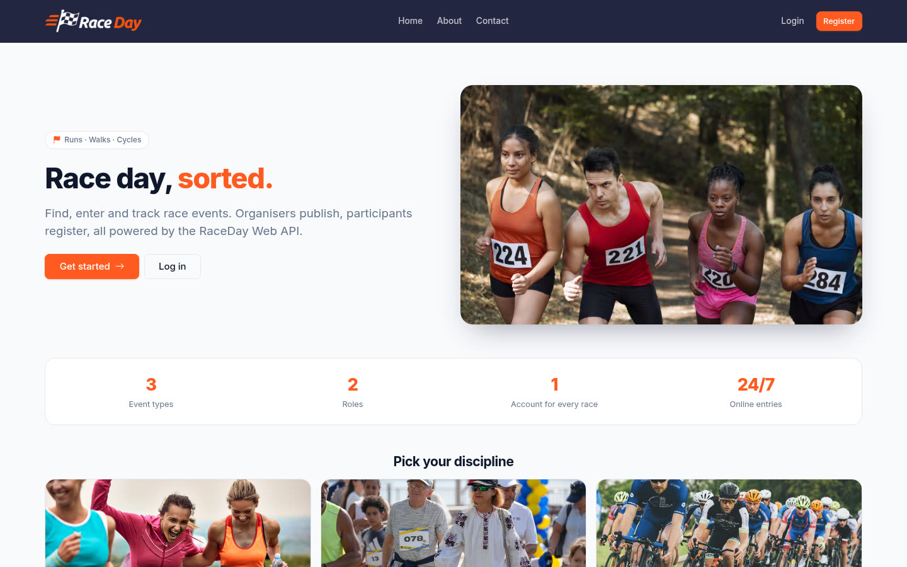<br/>
<em>Public home</em>
</td>
<td width="50%" valign="top" align="center">
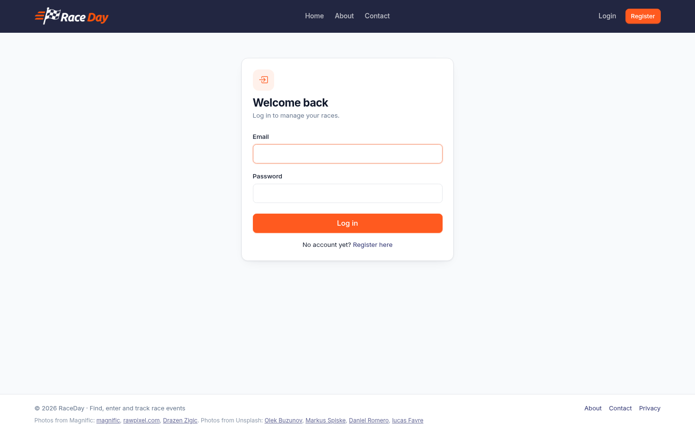<br/>
<em>Login</em>
</td>
</tr>
<tr>
<td width="50%" valign="top" align="center">
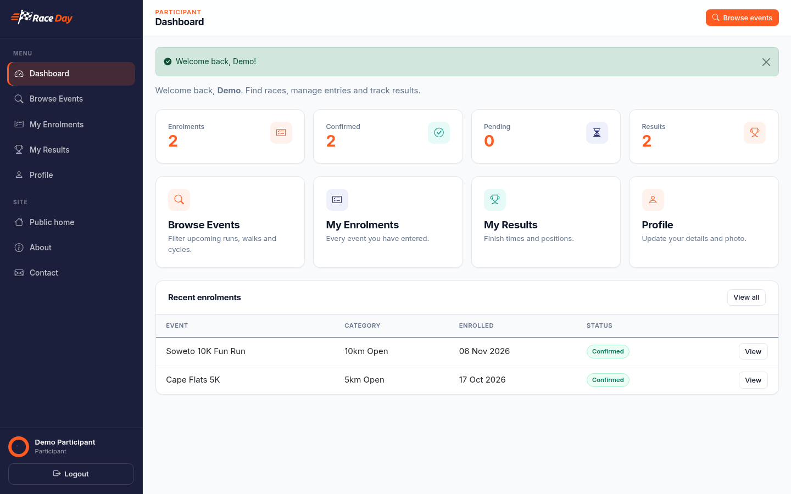<br/>
<em>Participant dashboard</em>
</td>
<td width="50%" valign="top" align="center">
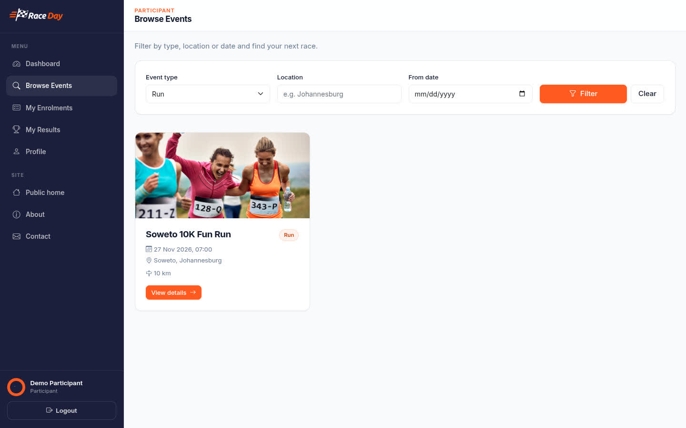<br/>
<em>Browse events with filters</em>
</td>
</tr>
<tr>
<td width="50%" valign="top" align="center">
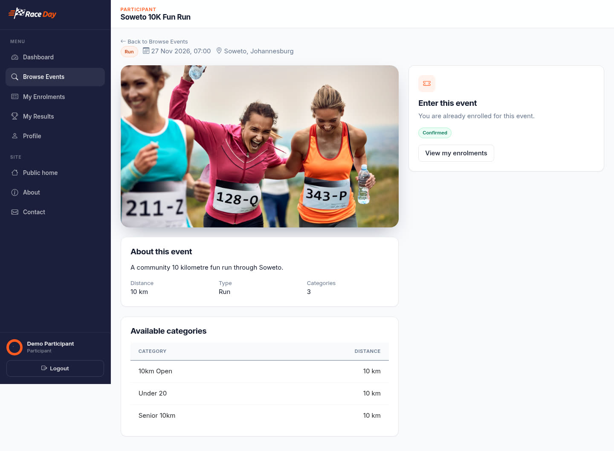<br/>
<em>Event details with banner and enrol</em>
</td>
<td width="50%" valign="top" align="center">
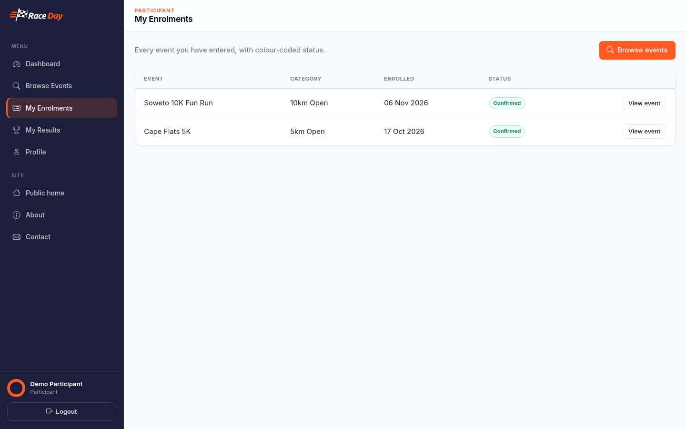<br/>
<em>My Enrolments (colour statuses)</em>
</td>
</tr>
<tr>
<td width="50%" valign="top" align="center">
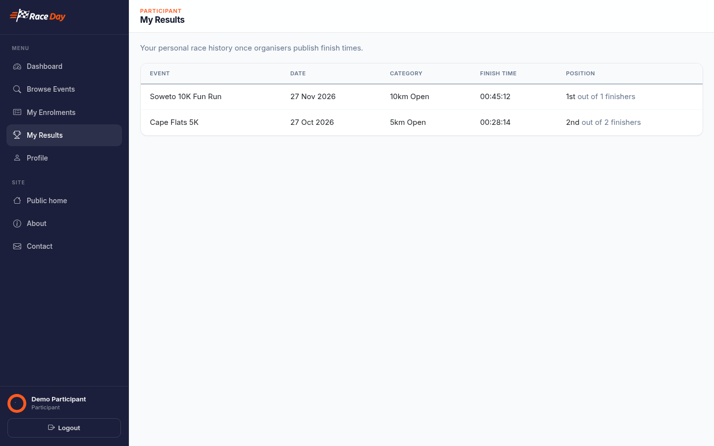<br/>
<em>My Results</em>
</td>
<td width="50%" valign="top" align="center">
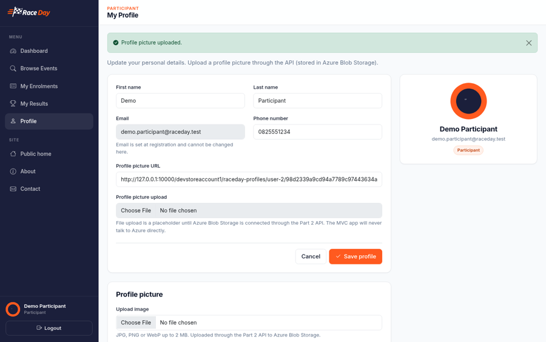<br/>
<em>Profile with picture upload</em>
</td>
</tr>
<tr>
<td width="50%" valign="top" align="center">
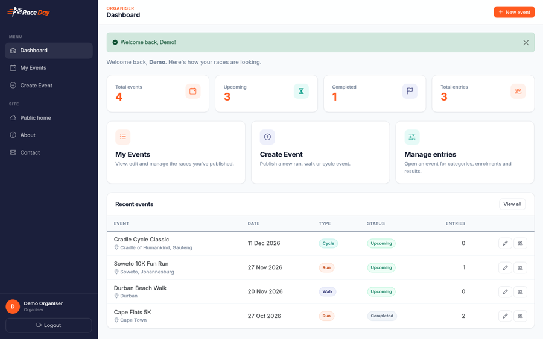<br/>
<em>Organiser dashboard</em>
</td>
<td width="50%" valign="top" align="center">
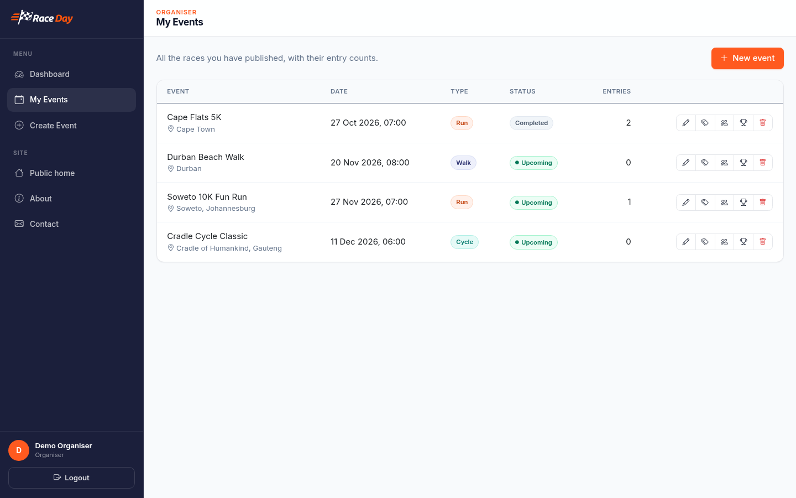<br/>
<em>My Events</em>
</td>
</tr>
<tr>
<td width="50%" valign="top" align="center">
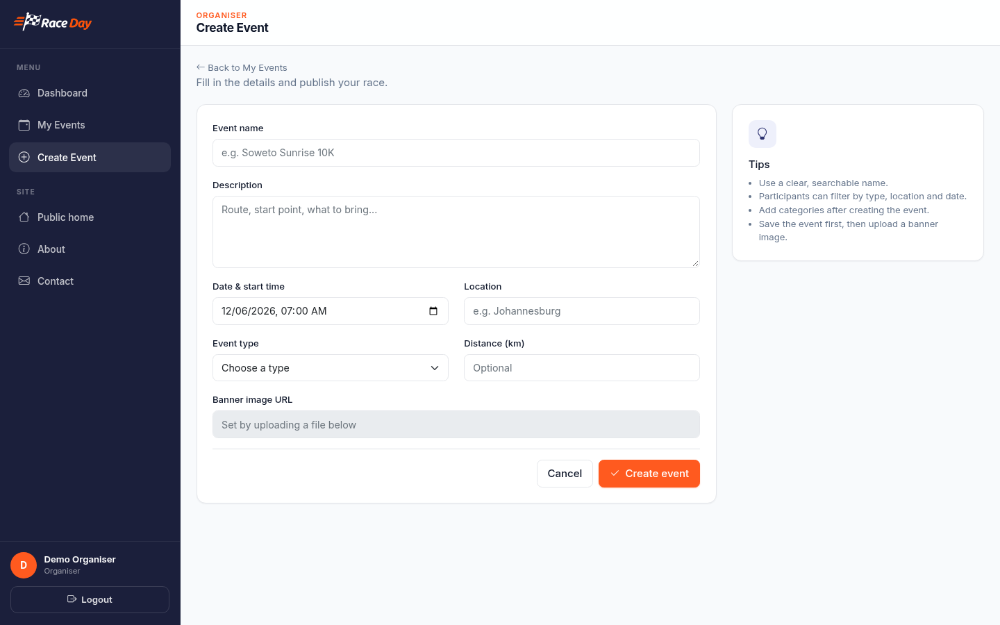<br/>
<em>Create event</em>
</td>
<td width="50%" valign="top" align="center">
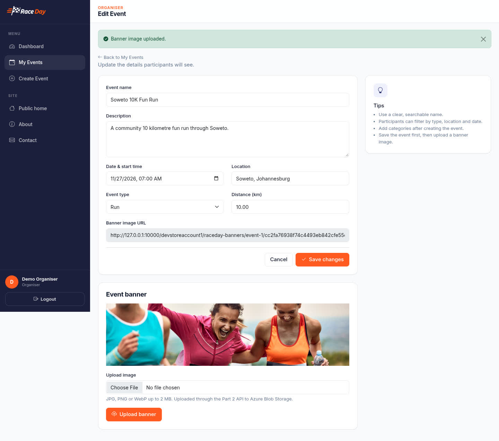<br/>
<em>Edit event with banner upload</em>
</td>
</tr>
<tr>
<td width="50%" valign="top" align="center">
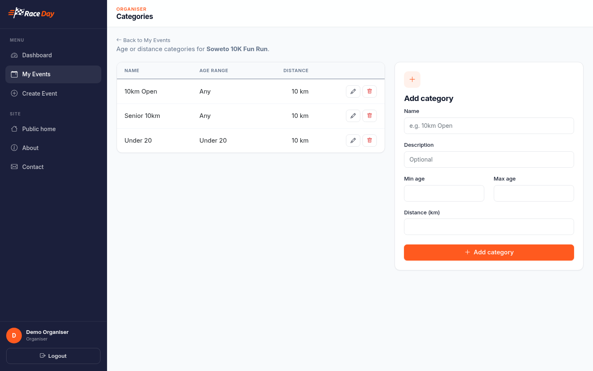<br/>
<em>Categories</em>
</td>
<td width="50%" valign="top" align="center">
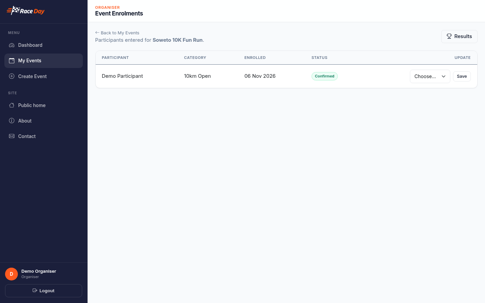<br/>
<em>Organiser enrolments</em>
</td>
</tr>
<tr>
<td width="50%" valign="top" align="center">
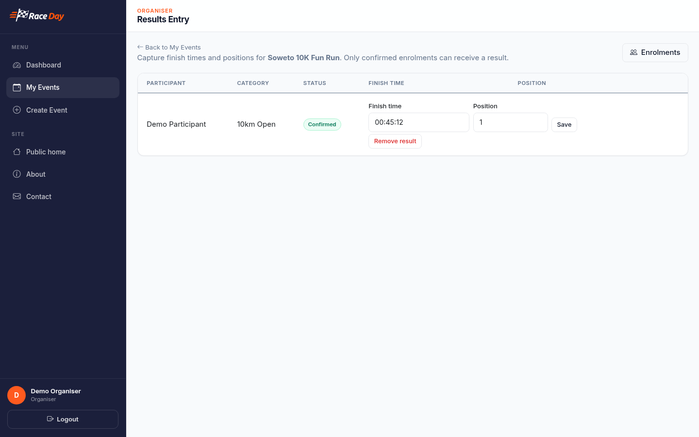<br/>
<em>Results entry</em>
</td>
<td width="50%" valign="top" align="center">
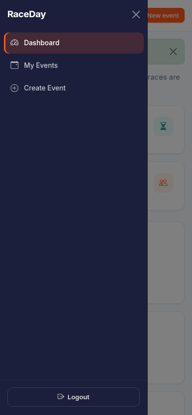<br/>
<em>Mobile offcanvas menu</em>
</td>
</tr>
</table>

## Tech stack

.NET 8 (Web API + MVC), Entity Framework Core with SQL Server, session auth with hashed passwords, Swagger in Development, xUnit tests, Azure Blob Storage (Azurite for local work), Bootstrap 5 and Bootstrap Icons, Docker multi-stage images, GitHub Actions. UI colours are navy `#1b1f3b` and orange `#ff5a1f`.

## Folder layout

```text
RaceDay-POE/
├── .github/workflows/
│   ├── part1-validation.yml
│   └── ci.yml
├── docs/
│   ├── ERD.png
│   ├── API-Endpoint-Plan.md
│   ├── RaceDay-Schema.sql
│   ├── images/
│   ├── workflow-run.png
│   └── part2-ci-run.png
├── RaceDay-POE-API/
├── RaceDay-POE-API.Tests/
├── RaceDay-POE-Web/
├── Dockerfile
├── Dockerfile.api
├── RaceDay-POE-API.sln
└── README.md
```

## What you need installed

.NET 8 SDK, SQL Server (LocalDB is fine), EF tools (`dotnet tool install --global dotnet-ef`), and Git. For image uploads locally, Node.js helps so you can run Azurite with `npx`. Docker is optional if you want containers.

## Setup

Clone and switch to the working branch:

```bash
git clone https://github.com/ray-ray102/RaceDay-POE.git
cd RaceDay-POE
git checkout poe-full-web-app
```

### Database

Default connection string in `RaceDay-POE-API/appsettings.json`:

```text
Server=(localdb)\MSSQLLocalDB;Database=RaceDayPOEDB;Trusted_Connection=True;MultipleActiveResultSets=true;TrustServerCertificate=True
```

Change `ConnectionStrings:RaceDayConnection` if your SQL Server is different, then apply migrations:

```bash
cd RaceDay-POE-API
dotnet ef database update
cd ..
```

`docs/RaceDay-Schema.sql` is the Part 1 SSMS script for reference. The running API uses the EF migrations.

### Blob storage secret

Do not commit real Azure keys. For local Azurite:

```bash
cd RaceDay-POE-API
dotnet user-secrets init
dotnet user-secrets set "ConnectionStrings:AzureBlobStorage" "UseDevelopmentStorage=true"
cd ..
```

### Azurite

```bash
npx azurite --silent --location ./azurite --blobHost 127.0.0.1 --blobPort 10000
```

Leave that running while you test banner and profile uploads. Development config already defaults to `UseDevelopmentStorage=true`.

### API

```bash
cd RaceDay-POE-API
dotnet run --urls http://localhost:5141
```

Swagger: `http://localhost:5141/swagger`

### Web app

`ApiSettings:BaseUrl` should point at the API (default `http://localhost:5141/` in `RaceDay-POE-Web/appsettings.json`):

```bash
cd RaceDay-POE-Web
dotnet run --urls http://localhost:5027
```

Or override from the repo root:

```bash
dotnet run --urls http://localhost:5027 --project RaceDay-POE-Web \
  -- --ApiSettings:BaseUrl=http://localhost:5141/
```

Open `http://localhost:5027` and register an Organiser or Participant account.

### Tests

```bash
dotnet test RaceDay-POE-API.sln
```

## Azure Blob Storage

Blob Storage lives only in the API. The MVC app never talks to Azure or Azurite. The browser posts a file to the web app, the web app forwards it to the API, the API checks the file, uploads through `IBlobStorageService`, and stores the public URL on the event or user.

Upload flow in plain steps:

1. Browser posts the banner or profile picture as multipart form data to the MVC web app.
2. The web app forwards that file to the API endpoint.
3. The API validates the file type and size.
4. The API uploads the stream through IBlobStorageService into the banners or profiles container.
5. The blob store returns a public URL.
6. The API saves that URL on the event or user record.
7. The web app re-renders the page and the image tag uses the stored URL.


Event banners go through Organiser edit to `POST /api/events/{id}/banner` into `BlobStorage:BannersContainer` (default `raceday-banners`). Profile pictures go through Participant Profile to `POST /api/users/me/picture` into `BlobStorage:ProfilesContainer` (default `raceday-profiles`).

`ImageUploadValidator` allows `image/jpeg`, `image/jpg`, `image/png`, `image/webp`, max 2 MB. Bad files get a 400 with a normal message.

Containers are created with public blob access so pages can use a normal ``. The URL is saved as `BannerImageUrl` or `ProfilePictureUrl`.

Config keys:

- `ConnectionStrings:AzureBlobStorage` — preferred connection string (user-secrets / env)
- `BlobStorage:ConnectionString` — fallback (defaults to `UseDevelopmentStorage=true` in Development)
- `BlobStorage:BannersContainer` / `BlobStorage:ProfilesContainer` — container names

`BlobStorageService` reads `ConnectionStrings:AzureBlobStorage` first, then the fallback.

### Local demo (Azurite)

I ran the demo with Azurite only — no real Azure account. Start Azurite, keep `UseDevelopmentStorage=true`, run API + web, upload a banner or picture in the UI. The URL lands in SQL and the image loads in the browser.

### Real Azure Storage

Create a Storage Account, then set the connection string without committing it:

```bash
cd RaceDay-POE-API
dotnet user-secrets set "ConnectionStrings:AzureBlobStorage" "<your-azure-storage-connection-string>"
```

Or with an environment variable:

```bash
export ConnectionStrings__AzureBlobStorage="<your-azure-storage-connection-string>"
```

Restart the API. Containers `raceday-banners` and `raceday-profiles` are created on first upload if needed.

## Docker

Web image (multi-stage Dockerfile at the repo root):

```bash
docker build -t raceday-web -f Dockerfile .
```

Run it against an API you already have running:

```bash
docker run --rm -p 8080:8080 \
  -e ApiSettings__BaseUrl=http://host.docker.internal:5141/ \
  raceday-web
```

Then open `http://localhost:8080`. On Linux you may need `--add-host=host.docker.internal:host-gateway`.

Optional API image:

```bash
docker build -t raceday-api -f Dockerfile.api .
docker run --rm -p 5141:8080 \
  -e ConnectionStrings__RaceDayConnection="<your-sql-server-connection-string>" \
  -e ConnectionStrings__AzureBlobStorage="<your-azure-or-azurite-connection-string>" \
  raceday-api
```

## CI/CD

`.github/workflows/part1-validation.yml` checks that the Part 1 docs and README are in place.

`.github/workflows/ci.yml` restores and builds the API, tests and MVC web, then runs the API unit tests. It runs on pushes to `main`, `part-2*`, `part-3*`, `final*` and `poe*` branches, and on PRs to `main`.

Green Part 2 and 3 CI run:

<p align="center">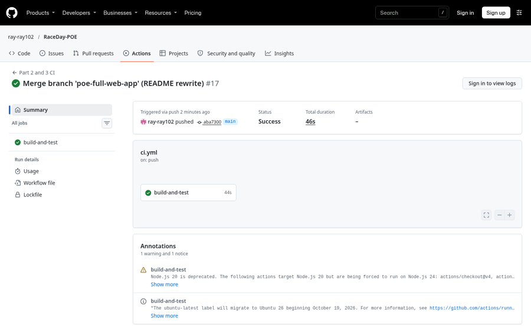</p>

Older screenshots: `docs/workflow-run.png` (Part 1) and `docs/part2-ci-run.png`.

## Part 1 files

- `docs/ERD.png` — ERD for Roles, Users, Events, Categories, Enrolments, Results
- `docs/API-Endpoint-Plan.md` — method, route, role, body, responses
- `docs/RaceDay-Schema.sql` — SQL Server create + seed script

Design choices: six tables; events owned by one Organiser (`OrganiserId`); enrolments link Participant + Event + Category with status Pending / Confirmed / Cancelled; results are one-to-one with enrolments (`FinishTime`, `FinishPosition`).

## Part 2 API (short list)

Auth: `POST /api/auth/register`, `login`, `logout` (public).  
Users: `GET/PUT /api/users/me`, `POST /api/users/me/picture` (logged in).  
Events: public `GET`; Organiser create/update/delete, `GET /api/events/mine`, `POST /api/events/{id}/banner`.  
Categories: public read; Organiser write.  
Enrolments: Participant enrol / mine; Organiser list + status.  
Results: Organiser capture/update/delete; Participant `GET /api/results/mine`.

Full detail is in `docs/API-Endpoint-Plan.md` and Swagger.

## Image credits

Magnific: [cross country](https://www.magnific.com/free-photo/different-people-participating-cross-country_20283238.htm), [team ready for race](https://www.magnific.com/free-photo/team-diverse-people-ready-race_2826771.htm) (rawpixel.com), [cheerful runners](https://www.magnific.com/free-photo/cheerful-runners-having-fun-while-participating-race-nature_26346847.htm) (Drazen Zigic).

Unsplash: [Olek Buzunov](https://unsplash.com/photos/people-walking-in-charity-run-OFsKQCFI9SE), [Markus Spiske](https://unsplash.com/photos/group-of-cyclist-on-asphalt-road-WUehAgqO5hE), [Daniel Romero](https://unsplash.com/photos/a-crowd-gathers-at-the-statesman-cap10k-race-qOhho1nnUVQ), [lucas Favre](https://unsplash.com/photos/silhouette-photo-of-a-person-running-on-road-JnoNcfFwrNA).

## References

- Microsoft Learn: [ASP.NET Core](https://learn.microsoft.com/aspnet/core/), [EF Core](https://learn.microsoft.com/ef/core/), [Session state](https://learn.microsoft.com/aspnet/core/fundamentals/app-state)
- [Azure Blob Storage](https://learn.microsoft.com/azure/storage/blobs/) and [Azurite](https://learn.microsoft.com/azure/storage/common/storage-use-azurite)
- [Docker docs](https://docs.docker.com/)
- [Bootstrap 5](https://getbootstrap.com/docs/5.3/) and [Bootstrap Icons](https://icons.getbootstrap.com/)
- [xUnit](https://xunit.net/) and [GitHub Actions](https://docs.github.com/actions)
- Unsplash and Magnific for the photos above

## Author

**Raesibe Betty Lelaka**  
Student Number: ST10485428
